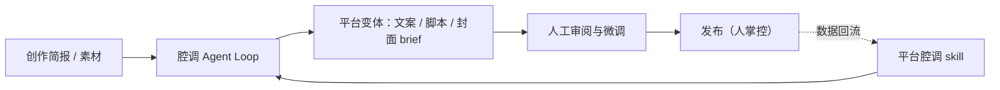

<h1 align="center">腔调 Timbre</h1>

  <strong>一稿千面，各凭腔调</strong> 
  本地优先的开源运营平台：内置各平台腔调 skill，一次创作，按平台长成它该有的样子

  
  
  

---

## 📖 这是什么

**腔调（Timbre）** 是一个本地优先的开源运营平台，参考 axiom（本地优先全栈工程 Agent）的形态：自研 Agent 运行时 + skill 体系 + 本地工作区，面向内容运营场景。

每个内容平台都有自己的腔调——同一件事，在抖音要前三秒钩子，在小红书要人设感与真诚分享，在 B 站要梗与信息密度，在 X 要锐评与话题性，在视频号要家常与信任感。腔调不做「一键同发」，它内置每个平台的**腔调 skill**：一次创作，针对每个平台产出符合其内容规律与语感的变体，发布决策仍由人掌控。

## ✨ 设计意向

### 平台腔调矩阵

平台清单与完整腔调要点以 [docs/platform-matrix.md](docs/platform-matrix.md) 为权威来源，下表仅为门面摘要，两者冲突以该文件为准。矩阵是设计意向而非已验证事实，修订与依据记在该文件的「修订记录」中。

| 平台 | 摘要 |
|---|---|
| 抖音 | 前三秒钩子、口语化、完播率 |
| 小红书 | 人设感、真诚分享、搜索友好 |
| B 站 | 梗与信息密度、分段节奏 |
| X | 锐评、thread 结构、长度克制 |
| 视频号 | 家常与信任感、社交转发 |

> 该矩阵将随 skill 体系迭代，欢迎各平台深度运营者按 [CONTRIBUTING.md](CONTRIBUTING.md) 修订。

### 核心循环

- **一稿千面**：创作简报进，平台变体出；变体不是翻译，是按平台腔调重写。
- **skill 即边界**：每个平台一个 skill 包，声明内容规律、范例、红线；社区可贡献新平台与新腔调。
- **本地优先**：素材、草稿、会话与密钥留在本地边界内（沿 axiom 的持久化与安全边界思路）。
- **人掌控发布**：本项目的边界是内容生产与变体审阅；实际发布动作保留人工确认（平台 API 自动化另有合规边界，见 Roadmap）。

## 🏗️ 技术选型（未定）

项目处于设计阶段，代码未开始。候选方向：

| 候选 | 说明 |
|---|---|
| Tauri 2 + React | 同 axiom 技术栈，生态成熟，webview 内存与启动为代价 |
| [MyGo](https://github.com/egoist/mygo) 原生 UI | Go + GPU 自绘，启动即时、内存低；此前已完成 axiom 页面替换可行性调研（结论：可行，重活在设计画布与运行时宿主；调研正文尚未归档，写入 ADR 前须补齐，见 [docs/adr/README.md](docs/adr/README.md)「待归档材料」） |

选型决策将随 MVP 范围（是否需要内嵌浏览器预览、多窗口、终端面板）一起评估，按 ADR 流程记录于 [docs/adr/](docs/adr/README.md)；命名决策与撞名证据另见 [docs/naming.md](docs/naming.md)。

## 🗺️ Roadmap

- [ ] **0.1 — Task Spec**：目标用户、平台清单、skill 体系形态、本地优先边界的规格收敛（[`.specs/`](.specs/tasks/README.md)）
- [ ] **0.2 — 技术选型 ADR**：桌面运行时与 agent 运行时语言决策（[`docs/adr/`](docs/adr/README.md)）
- [ ] **0.3 — MVP**：单平台（拟小红书）腔调 skill + 创作简报 → 变体 → 审阅的最小闭环
- [ ] **0.4 — 多平台**：`docs/platform-matrix.md` 所列平台的腔调 skill 全量
- [ ] **0.5 — 发布对接**：各平台发布能力与合规边界评估

## 📛 命名

腔调 / Timbre：「timbre」即音色——同一旋律经不同乐器发出不同的声，正如同一件事在不同平台长出不同的讲法。命名调研与撞名证据见 [docs/naming.md](docs/naming.md)。

## 🤝 参与

贡献流程、文档约定与不可接受的边界见 [CONTRIBUTING.md](CONTRIBUTING.md)；安全边界与漏洞上报方式见 [SECURITY.md](SECURITY.md)。

## 📄 许可

MIT，见 [LICENSE](LICENSE)。
